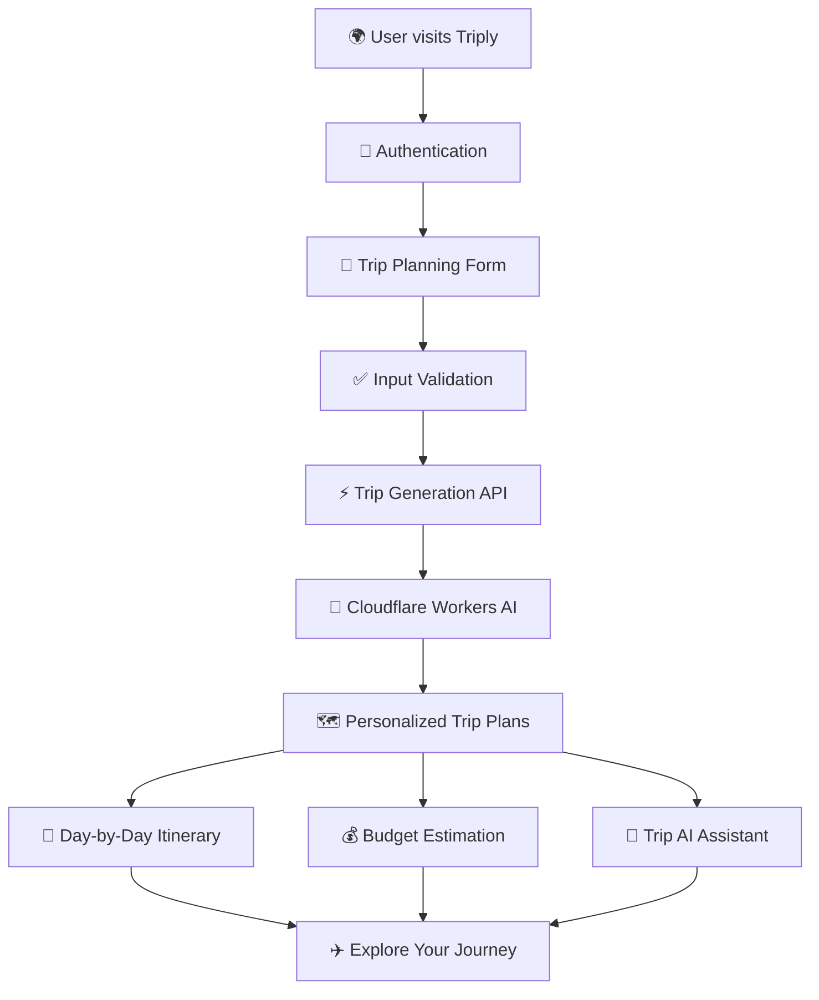

# ✈️ Triply — Your Next Adventure Starts Here

<p align="center">
  
</p>

<p align="center">
  <strong>Less planning stress. More travel memories.</strong>
  <br />
  An AI-powered travel planner that turns your travel ideas into personalized journeys.
  <br /><br />
  <a href="https://triply-sepia.vercel.app/"><strong>🌍 Explore Live Demo</strong></a>
  &nbsp; · &nbsp;
  <a href="https://github.com/Kartikp12/Triply"><strong>⭐ View Repository</strong></a>
</p>

<p align="center">
  
  
  
  
  
</p>

---

## 🌍 What is Triply?

Planning a trip should be exciting, not exhausting.

Searching for destinations, comparing travel options, managing budgets, and organizing daily activities can quickly become overwhelming.

**Triply is an AI-powered travel planning platform designed to make that process simpler.**

Tell Triply where you want to go, how long you want to travel, who is coming along, and what your budget looks like. Triply helps turn those preferences into personalized travel plans.

Whether it's a family vacation, a couple's getaway, or an adventure with friends — your next journey starts here.

## ✨ Features That Make Travel Planning Better

<table>
  <tr>
    <td width="50%">
      <h3>🗺️ Personalized Trip Planning</h3>
      Create trip plans based on destination, duration, travellers, budget, travel style, and interests.
    </td>
    <td width="50%">
      <h3>🤖 AI-Powered Itineraries</h3>
      Generate multiple travel plan options tailored to your preferences using AI.
    </td>
  </tr>
  <tr>
    <td width="50%">
      <h3>📅 Day-by-Day Itinerary</h3>
      Explore activities and recommendations organized around each day of your trip.
    </td>
    <td width="50%">
      <h3>💰 Budget Estimation</h3>
      Understand estimated trip expenses and make more informed travel decisions.
    </td>
  </tr>
  <tr>
    <td width="50%">
      <h3>💬 AI Trip Assistant</h3>
      Chat with an AI assistant associated with your selected itinerary to ask questions about your trip.
    </td>
    <td width="50%">
      <h3>👥 Group-Based Planning</h3>
      Plan journeys for couples, families, and groups of friends with different travel preferences.
    </td>
  </tr>
  <tr>
    <td width="50%">
      <h3>📍 Smart City Autocomplete</h3>
      Find and select destinations more easily while filling out the trip planner.
    </td>
    <td width="50%">
      <h3>🔐 Authentication & Dashboard</h3>
      Sign up, sign in, and access a protected dashboard for your Triply experience.
    </td>
  </tr>
</table>

## 🚀 The Triply Experience

### 01 — Tell Us About Your Journey

Provide the details that matter:

- Starting point and destination
- Travel dates and trip duration
- Number of travellers
- Adults and children
- Total trip budget and currency
- Travel style and transportation preferences
- Interests and special requirements

### 02 — Let AI Build Your Trip

Triply uses Cloudflare Workers AI to generate personalized travel plan options based on your trip preferences.

### 03 — Explore Your Itinerary

Review your travel options, explore day-by-day activities, and compare estimated budgets.

### 04 — Ask Your AI Travel Assistant

Have questions about your selected itinerary? Use the trip-specific AI assistant to explore your travel plans and get additional guidance.

<p align="center">
  
</p>

## 🧠 AI Behind Triply

Triply explores how AI can make travel planning more personalized and interactive.

**AI capabilities include:**

- Preference-based itinerary generation
- Multiple travel plan options
- Day-wise itinerary generation
- Budget-aware planning
- Trip-specific conversational assistance
- Chunk-based generation for longer trips

The AI integration uses **Cloudflare Workers AI** with the `@cf/zai-org/glm-4.7-flash` model.

## 🛠️ Technology Stack

| Technology | Purpose |
|---|---|
| Next.js | Application framework and API routes |
| React | Interactive user interface |
| JavaScript | Application logic |
| Tailwind CSS | Responsive styling |
| Firebase Authentication | User authentication |
| Cloudflare Workers AI | AI-powered trip planning |
| GLM-4.7-Flash | Language model |
| LangGraph | Agent workflow exploration |
| Zod | Schema validation |
| Vercel | Deployment |

## 🏗️ Application Workflow



## 🎨 Built for a Better Experience

Triply focuses on more than just generating itineraries.

- Clean and modern travel-focused interface
- Responsive layouts for different screen sizes
- Smooth animations and interactive elements
- Intuitive trip planning experience
- Clear presentation of travel plans and budgets
- Dedicated experience for exploring individual trips

## 💻 Getting Started

Want to explore Triply locally?

### Prerequisites

- Node.js
- npm
- Firebase project
- Cloudflare account with Workers AI access

### Installation

**1. Clone the repository**

```bash
git clone https://github.com/Kartikp12/Triply.git
cd Triply
```

**2. Install dependencies**

```bash
npm install
```

**3. Configure environment variables**

Create a `.env.local` file in the root directory.

Add the Firebase and Cloudflare environment variables expected by the application code.

```env
# Firebase configuration
NEXT_PUBLIC_FIREBASE_API_KEY=
NEXT_PUBLIC_FIREBASE_AUTH_DOMAIN=
NEXT_PUBLIC_FIREBASE_PROJECT_ID=
NEXT_PUBLIC_FIREBASE_STORAGE_BUCKET=
NEXT_PUBLIC_FIREBASE_MESSAGING_SENDER_ID=
NEXT_PUBLIC_FIREBASE_APP_ID=

# Cloudflare Workers AI configuration
CLOUDFLARE_ACCOUNT_ID=
CLOUDFLARE_API_TOKEN=
```

Use the exact variable names expected by your implementation. Never commit private credentials or API tokens.

**4. Start the development server**

```bash
npm run dev
```

**5. Open Triply**

```text
http://localhost:3000
```

## 🔮 What's Next?

Triply is continuously evolving.

Some areas for future improvements include:

- More accurate and context-aware travel recommendations
- Enhanced itinerary personalization
- Improved trip management and persistence
- More interactive destination discovery
- Better travel insights and recommendations

## 🤝 Contributing

Have an idea that could make Triply better?

Contributions, suggestions, and feedback are welcome. Feel free to open an issue or submit a pull request.

## 👨‍💻 Built With Curiosity

Triply is an exploration of how modern web technologies and AI can improve everyday travel planning.

<p align="center">
  <strong>Have a destination in mind?</strong>
  <br />
  Let Triply help you plan the journey.
  <br /><br />
  <a href="https://triply-sepia.vercel.app/">
    
  </a>
</p>

<p align="center">
  
</p>